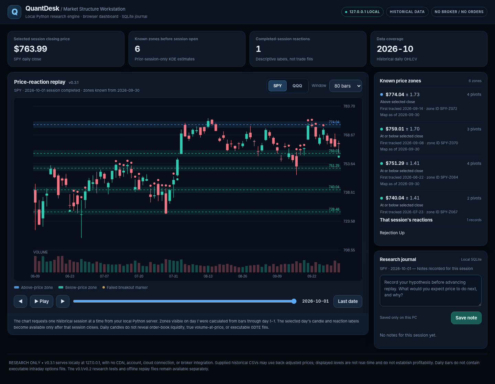

# QuantDesk — Market Structure Workstation

> An offline-first, Python-powered research workstation for investigating historical SPY and QQQ price-reaction zones.



*Interface preview from v0.3.1. The public repository omits historical market-data files, credentials, personal research journals, and generated reports.*

## Why I built this


I used to trade options when I was younger but ended up straying away from it as time passed. I figured something to get me back into trading while also taking time off my hands would be a great project, so I schemed with chatgpt on how to come up with a cool project to knock out a few birds with one stone. I wanted to test whether recurring historical price reactions can be found mathematically rather than relying only on manually drawn support and resistance lines. QuantDesk detects candidate zones and lets me replay historical sessions without revealing future candles.

## What it does

- **Point-in-time levels:** identifies confirmed swing pivots and groups nearby reaction prices using kernel density estimation (KDE) and ATR-based scaling.
- **Historical replay:** daily SPY/QQQ candlesticks, dynamically known price zones, session navigation, and completed-session reaction labels.
- **Local web app:** browser dashboard served by a Python HTTP server on `127.0.0.1`; no cloud services required.
- **Research notebook:** timestamped session notes stored in a local SQLite database.
- **Exploratory analysis:** candidate-level event studies and historical comparison tools.
- **No order execution:** research-only by design, with no broker orders or real-time trading connection.

## Stack

Python · NumPy · pandas · Matplotlib · SQLite · HTML · CSS · JavaScript · unittest

## Run it locally (Windows / synthetic demo)

Requires Python 3.10+ and PowerShell. In this repository folder:

```powershell
py -3 -m venv .venv
.\.venv\Scripts\python.exe -m pip install -r requirements.txt
.\.venv\Scripts\python.exe -m market_structure_lab.demo --output-dir data_demo
.\.venv\Scripts\python.exe -m market_structure_lab.workstation --data-dir data_demo
```

Open **http://127.0.0.1:8765/** and keep the terminal open. Press `Ctrl+C` to stop the server. After installing dependencies, you can also double-click `start_demo.bat`.

**Demo data is completely synthetic.** It's for verifying the app, not backtesting an investment strategy.

### Bring your own historical daily candles

Create `data/SPY.csv` and `data/QQQ.csv`, each with ascending records in this format:

```csv
date,open,high,low,close,volume
```

Run:

```powershell
.\.venv\Scripts\python.exe -m market_structure_lab.workstation --data-dir data
```

Or double-click `start_workstation.bat`. The optional `market_structure_lab.fetch_alpaca` module can download historical daily bars with credentials supplied via environment variables. **Do not commit data unless you have redistribution rights.**

## Tests

```powershell
.\.venv\Scripts\python.exe -m unittest discover -s tests_market_structure -v
```

The tests cover chronological level availability, replay behavior, invalid inputs, local API behavior, and UI invariants. A GitHub Actions workflow runs them on pushes and pull requests.

## Project structure

```text
market_structure_lab/       Research engine, replay, local server, frontend
  assets/workstation.html   HTML/CSS/JavaScript browser dashboard
tests_market_structure/    Automated tests
docs/                     Architecture, data notes, release history, screenshots
.github/workflows/         CI tests
start_demo.bat             Synthetic demo launcher
start_workstation.bat      Local historical-data launcher
```

## Limitations & disclaimer

**This is an experimental research prototype, not a proven profitable trading system.** It uses historical daily underlying ETF OHLCV, not true intraday order flow, executable options quotes, or live order-book liquidity. Observed price reactions are not executable fills. No option P&L, production broker integration, or reliable trading edge is established. Historical holdout results have already been examined and must not be treated as untouched validation for future tuned models.

## Roadmap

- [x] v0.1 — Causal pivot detection and KDE price zones
- [x] v0.2 — Historical replay and exploratory validation
- [x] v0.3 — Local server, API, and SQLite journal
- [x] v0.3.1 — Midnight Navy UI redesign
- [ ] v0.4 — Intraday data ingestion and multi-timeframe replay
- [ ] Future — Licensed volume-at-price research, market regimes, options analysis, and locally assisted ML research

See [docs/ROADMAP.md](docs/ROADMAP.md).

## About me

I'm a 20 year-old at Broward College, and I like making stuff in my free time. I figured I should start pushing these projects to github instead of just leaving them sitting on my pc for no one to see, so here's a start. I recently pushed my first ever github repo at plutohacks hackathon and that inspired me to start doing more. I used chatgpt to help me complete this project.


## License

This project is licensed under the MIT License.
See the [LICENSE](LICENSE) file for the full license terms.

Copyright © 2026 Simon Garcia.
