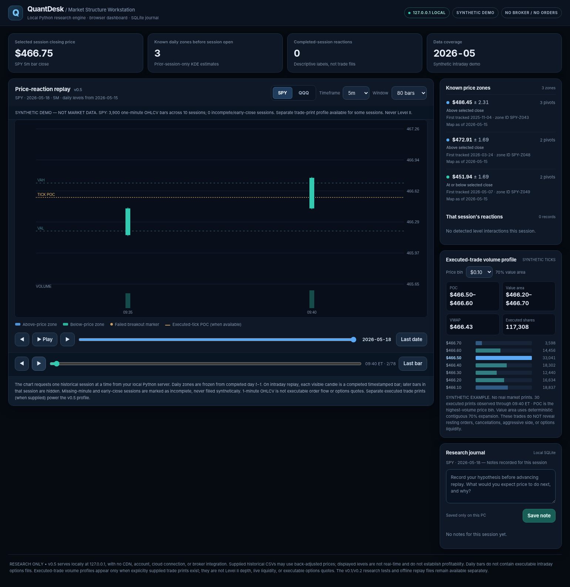

# QuantDesk v0.5 — Executed-Trade Volume Profile

> **Research-only · no live trading · no broker orders · no alpha claims**

v0.5 adds a **true, trade-derived volume-at-price histogram** to the existing v0.4 historical replay. It deliberately does **not** derive a pseudo profile from OHLCV candle volume.



*Actual v0.5 dashboard rendering from fabricated demo prints; not market data.*

## Install in your existing GitHub repo

1. Stop the workstation (`Ctrl+C`). Make sure you have a clean working tree or have committed any changes.
2. `git switch main` and `git pull --ff-only origin main`.
3. Create the feature branch: `git switch -c feature/v0.5-volume-profile`.
4. Extract the **v0.5 upgrade ZIP** into the existing `QuantDesk_Market_Structure_v0_3` repository root, merging folders. **The patch intentionally does not include your customized root README, LICENSE, personal database, or historical data files.**
5. Run from PowerShell:

```powershell
.\.venv\Scripts\python.exe -m pip install -r requirements.txt
.\.venv\Scripts\python.exe -m unittest discover -s tests_market_structure -v
```

The 43-test suite includes source validation, exact price-bin assignment, value-area arithmetic, forward-trade exclusion, server APIs, and regression tests.

## Run an entirely synthetic demo

Use **synthetic examples only** to confirm that the dashboard works. They cannot validate any strategy.

```powershell
.\.venv\Scripts\python.exe -m market_structure_lab.demo --output-dir data_demo
.\.venv\Scripts\python.exe -m market_structure_lab.intraday_demo --data-dir data_demo --days 10
.\.venv\Scripts\python.exe -m market_structure_lab.volume_profile_demo --data-dir data_demo
.\.venv\Scripts\python.exe -m market_structure_lab.workstation --data-dir data_demo
```

Open `http://127.0.0.1:8765/`. Set timeframe to **1m/5m** and step through bars; notice that the POC and value area change **only after trades have become historically observable**. The UI labels any synthetic profile clearly.

The generator writes labeled demonstration tick prints to `data_demo/trades/SPY_trades.csv` and `QQQ_trades.csv`. These are mathematically fabricated prints, **not exchange transactions**. No actual market dataset is bundled.

## Optional Alpaca historical trade download (READ-ONLY)

The included optional REST adapter can fetch **historical executed stock prints** for one symbol, one 7-day calendar window at a time, **if your account has access to the selected feed**. It uses the documented Alpaca v2 historical stock-trades endpoint, never calls broker/order endpoints, and reads credentials from environment variables. It is not a real-time streamer. The feed may be restricted or delayed depending on your entitlement. **SIP** has consolidated trade coverage; **IEX** is only a subset of market prints. The exporter keeps exchange and condition columns for audit but does **not** yet implement a vetted trade-correction or condition-filter policy.

Set your Alpaca credentials locally in PowerShell (do not enter actual secrets in GitHub/chat):

```powershell
$env:APCA_API_KEY_ID = "YOUR_KEY"
$env:APCA_API_SECRET_KEY = "YOUR_SECRET"
.\.venv\Scripts\python.exe -m market_structure_lab.fetch_alpaca_trades --symbol SPY --start 2026-09-28 --end 2026-09-30 --feed sip
```

The resulting `data/trades/SPY_trades.csv` is **local and ignored by Git**. You need matching daily data and, for 1m/5m replay, matching 1-minute data for those same sessions. This downloader **will not overwrite** an existing trades CSV unless you explicitly pass `--overwrite`; it does not append multiple ranges. The parser's 2 million trade-print cap applies. HTTP access, source entitlement, and quality/condition handling have **not been exercised with real account credentials in this release**; they require your own integration test.

Reference: [Alpaca single-symbol historical trades](https://docs.alpaca.markets/us/reference/stocktradesingle-1).

## Import REAL executed-trade data

Store your own legally obtained, normalized US equity execution prints here:

```text
data/
  SPY.csv                       # Existing DAILY OHLCV
  QQQ.csv
  intraday/
    SPY_1m.csv                  # Existing 1-minute OHLCV
    QQQ_1m.csv
  trades/
    SPY_trades.csv              # NEW: executed trade prints (NOT quotes)
    QQQ_trades.csv
```

Required CSV headers:

```csv
timestamp,price,size
2026-09-30T09:30:00.321-04:00,600.01,100
2026-09-30T09:30:00.500-04:00,600.02,50
```

**Important:** The opening auction at exactly `09:30:00` is permitted; trades outside the regular session are not. The importer accepts only `09:30:00 <= time <= 16:00:00` US/Eastern on weekdays. It requires a timezone offset or `Z`, chronological rows, strictly positive prices and integral share sizes, and limits each input CSV to 2 million rows. It does **not** correct for US market holidays, early closes, trade-condition codes, retractions, off-exchange reporting differences, or source licensing; **you must filter/normalize these upstream** when using a real data provider. Session days must also occur in the existing eligible daily level maps.

Future production data connectors should standardize exchange trade condition codes and cancellations, include feed coverage metadata, handle early closes, and use chunked/columnar storage for much larger datasets. The current in-memory CSV importer is a research prototype.

Restart the workstation with:

```powershell
.\.venv\Scripts\python.exe -m market_structure_lab.workstation --data-dir data
```

The app will show profiles only on dates for which trade prints exist. **It will never silently invent volume-at-price from OHLCV**. The `data/`, `data_demo/`, and `outputs/` directories are already in `.gitignore`; do not publish licensed datasets.

### Data source integrity

- The source file SHA-256 appears in `/api/status` and in `/api/profile` responses.
- Trade prints are assumed to be already normalized and reflect executed trades; the project cannot prove whether a CSV comes from consolidated SIP, one venue, or invented data.
- Demonstration prints include a `source_label=SYNTHETIC_DEMO` column and remain labeled as synthetic by the API even if moved to a new folder.
- **Back-adjusted daily SPY/QQQ prices may not match as-traded tick prices.** Align adjustment conventions and corporate-action timestamps before overlaying daily zones against raw tick prices.

## What the profile actually calculates

For prices \(p_i\), executed sizes \(q_i\), and price-bin width \(\Delta p\):

- **Bin assignment**: \(b_i = \lfloor p_i / \Delta p\rfloor\). Decimal rounding is used before bin allocation so that e.g. a trade precisely on an edge is not misplaced by binary floating-point error.
- **Volume by price**: \(V(b)=\sum_{i:b_i=b} q_i\).
- **Point of Control (POC)**: the bin with the highest volume. Ties are resolved by closest bin midpoint to VWAP, then lower price.
- **VWAP**: \(\sum_i p_iq_i / \sum_iq_i\).
- **Value Area (VAH / VAL)**: Start at POC and grow a *contiguous* set of adjacent price bins, greedily choosing the neighboring bin with more volume (ties choose lower bin), until at least 70% of the session's observed executed share volume is included. There are multiple legitimate value-area algorithms; this is our **explicit convention**, not an industry oracle.
- **HVN/LVN**: preliminary local-max/min labels based on adjacent bins and heuristic thresholds. These are descriptive, unvalidated indicators; they should not be treated as statistically identified liquidity or automatic trade signals.

### Point-in-time replay guarantee

In historical **intraday** replay, the profile's cutoff is the current completed candle's end timestamp. Only prints whose timestamps are at or before that instant contribute. The daily KDE zones still use the prior completed daily session. A **daily** replay displays the *completed day's full profile*, not a morning profile.

New endpoint:

`GET /api/profile?symbol=SPY&date=2026-09-30&timeframe=5m&bar=8&price_bin=0.05`

Allowed price bins: `0.01, 0.05, 0.10, 0.25, 0.50, 1.00`. The API reports unavailable profiles with `available:false`, not fake rows.

## What this is NOT

Executed trade volume **is not** outstanding limit orders, a consolidated full-depth order book, aggressor-side delta, cumulative volume delta, options volume, open interest, or OPRA quotes. You cannot infer one from the other. This prototype does **not** estimate fill likelihood or trade profitability and is not connected to a broker.

## Proposed v0.5 follow-up research

- Compare POC/VAH/VAL from prior **completed** session with price reactions in the following session.
- Match those observations against volatility/trend controls, on event dates not already used for tuning.
- Investigate print-condition normalization and historical source-quality checks.
- Only then consider whether the profile adds predictive value beyond the existing KDE levels.

## Version control

After testing on your PC, commit to the feature branch and open a pull request to `main` as with v0.4. Do not paste over your main README; link `README_V05.md` from it when ready.
